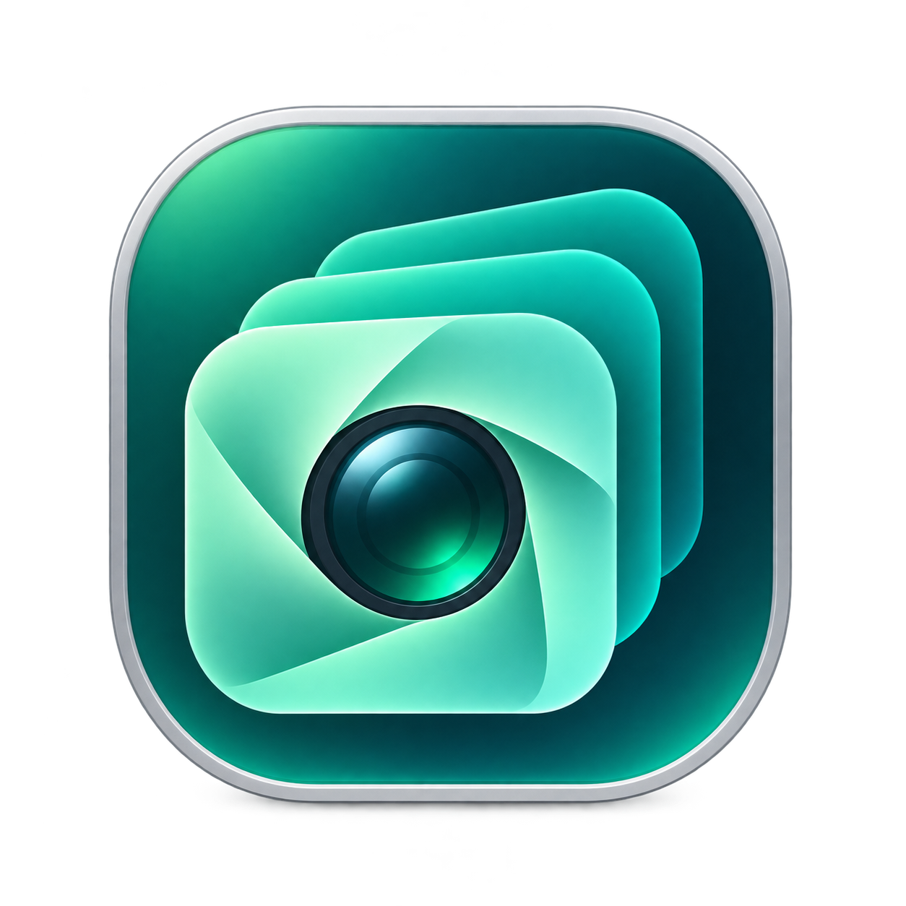
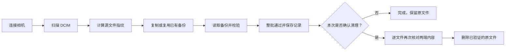

<div align="center">



# ActionVault

### 每一段精彩，都值得留下。

为 DJI Action 打造的原生 macOS 素材备份工具。  
连接相机，选择位置，让视频和照片有序归档。

**macOS 13+** · **Apple Silicon & Intel** · **SwiftUI** · **无第三方依赖**

**[⬇ 下载 macOS 通用版 DMG](https://github.com/aaronwork1205/ActionVault/releases/download/v1.0.2/ActionVault.dmg)** · [版本说明与校验文件](https://github.com/aaronwork1205/ActionVault/releases/tag/v1.0.2)

[快速开始](#快速开始) · [备份如何工作](#备份如何工作) · [常见问题](#常见问题) · [开发与打包](#开发与打包)

</div>

---

## 它能帮你做什么

拍摄结束后，把相机里的素材备份到 Mac、外置硬盘或 NAS；需要腾出空间时，再选择清理已经验证过的原文件。

| 功能 | 你会得到什么 |
| --- | --- |
| 📷 相机识别 | 发现 USB 文件传输模式下、包含 DCIM 的外置存储盘，提示识别 DJI 素材目录 |
| 📁 自由选择位置 | 备份到本机文件夹、外置磁盘或已挂载的 NAS / SMB 网络共享 |
| ⚡ 连接后自动备份 | 应用运行时，检测到 DJI 存储盘后自动尝试备份 |
| 🧩 增量备份 | 同路径、同名称、同内容的素材复用已有备份；同名不同内容分别保留 |
| 🔍 完整性校验 | 使用 SHA-256 内容指纹，核对复制前后的文件内容 |
| 🧹 可选清理 | 整批备份验证成功后，才清理对应的相机原文件 |
| 🧾 备份记录 | 每次任务生成逐文件记录，包含路径、指纹与删除状态 |

> **当前状态：本地试用版。** 已通过 9 项备份核心测试，生成的通用 DMG 已通过镜像校验。真实 DJI 相机与 NAS 环境仍需联调；当前安装包为本机 ad-hoc 签名，尚未进行 Apple Developer ID 签名和公证。

## 快速开始

### 1 · 安装应用

打开构建产物 `dist/ActionVault.dmg`，将 **ActionVault** 拖入 **Applications（应用程序）**，然后启动。

需要 **macOS 13 或更新版本**。通用安装包同时包含 Apple Silicon 和 Intel 架构。若项目中还没有安装包，请查看下方的[开发与打包](#开发与打包)。

### 2 · 连接相机

使用支持数据传输的 USB 线连接 DJI Action，在相机屏幕选择 **「文件传输 / File Transfer: USB」**。

应用会列出包含 `DCIM` 文件夹的外置本地存储盘。没有自动找到时，点击 **「刷新设备」**，或用 **「手动选择相机…」** 选择包含 `DCIM` 的磁盘根目录。

### 3 · 选择备份位置

点击 **「选择位置…」**，选择素材的保存文件夹。

| 保存到哪里 | 如何选择 |
| --- | --- |
| Mac 本机 | 选择本机上的文件夹 |
| 外置硬盘 | 连接硬盘后，选择其中的文件夹 |
| NAS / 网络共享 | 点击「连接网络存储…」，输入 `smb://服务器/共享名`；在 Finder 完成认证与挂载后，再选择共享中的文件夹 |

网络登录由 macOS / Finder 处理。备份位置不能在相机磁盘上，也不能与相机源目录互相包含。

### 4 · 开始备份

点击 **「开始备份」**，保持相机与目标磁盘连接。窗口会显示当前阶段、文件名、文件数量和数据量。

完成后，点击 **「查看备份与记录」**，即可在 Finder 中查看素材和任务记录。

> 默认保留相机原文件。只有勾选 **「本次手动备份后，删除相机中的原文件」** 并确认后，才会在验证成功后执行清理。删除是永久的，不经过废纸篓。

## 备份如何工作



**先验证，再清理。** 新文件先复制到临时文件，完成写入、同步和内容校验后，才转为正式备份。已有备份也会重新校验，不会仅凭文件名判定成功。

备份范围是 `DCIM` 下的所有非隐藏普通文件，包括视频、照片和附属文件。跳过符号链接，不备份 `DCIM` 之外的固件、日志或设置。

### 手动与自动，有什么区别？

| 行为 | 手动备份 | 自动备份 |
| --- | --- | --- |
| 触发方式 | 点击「开始备份」 | 应用运行时检测到 DJI 存储盘 |
| 前提 | 选择源设备与备份位置 | 已启用自动备份，并设置备份位置 |
| 内容校验 | ✅ | ✅ |
| 复用已验证的备份 | ✅ | ✅ |
| 删除相机原文件 | 可选，需要确认 | 始终保留 |
| 失败后重试 | 可手动重新开始 | 本次连接不反复自动重试，可手动重试 |

自动识别依据磁盘名称中的 DJI / OSMO 标记或 DJI 素材目录，**不验证具体相机型号**。每个识别出的存储盘每次连接自动尝试一次；应用启动时也会检查当前已连接的存储盘。

### 素材保存在哪里？

```text
你选择的备份文件夹/
└── ActionVault/
    ├── Media/
    │   └── DCIM/
    │       └── 原相机目录/
    │           ├── DJI_0001_<SHA256>.MP4
    │           └── DJI_0002_<SHA256>.JPG
    └── Reports/
        └── <任务 UUID>.json
```

文件名中的 `<SHA256>` 实际为完整的 64 位十六进制内容指纹，用来区分相机编号重置后的同名素材。视频和照片保持原始内容，不转码、不压缩。

记录文件保存原始相对路径、备份路径、指纹、大小，以及是否复用、是否删除等信息。需要恢复原始文件名时，可根据记录对应还原；当前没有一键恢复界面。

### 中断或异常时会怎样？

| 情况 | 应用行为 |
| --- | --- |
| 复制或整批校验阶段失败 | 停止任务，不进入清理阶段，保留已经完成的备份 |
| 点击「停止任务」 | 在取消检查点停止，保留已完成的备份 |
| 清理阶段停止或失败 | 停止后续删除；已经删除的源文件可从备份恢复 |
| 同名文件内容不同 | 保存为不同文件，不覆盖旧素材 |
| 已有备份内容损坏 | 校验失败并停止，不将其视为可复用备份 |
| 应用被强制退出 | 可能留下隐藏的 `.partial` 文件；重新运行会重拷未完成文件 |

删除与记录写入不是跨磁盘事务，异常断电时记录可能落后于实际删除状态。校验能够确认读回的内容一致，但不能替代 NAS 的持久化保证。重要素材建议保留第二份独立副本后再清理。

## 常见问题

<details>
<summary><strong>连接了相机，为什么没有出现在列表里？</strong></summary>

请确认 USB 线支持数据传输，并在相机上选择文件传输模式。然后检查 Finder 是否已经显示相机存储盘，且其中存在 `DCIM` 文件夹。

当前版本读取的是已挂载的文件系统，不支持摄像头模式或未挂载为磁盘的 MTP 设备。如果 Finder 已能看到磁盘，可以尝试刷新或手动选择根目录。

连接步骤也可参考 [DJI 官方文件传输排障说明](https://repair.dji.com/help/content?customId=01700009294&documentType=&lang=en&paperDocType=ARTICLE&re=US&spaceId=17)。

</details>

<details>
<summary><strong>为什么 NAS 地址不能直接作为备份文件夹？</strong></summary>

应用通过 macOS 文件系统访问网络共享。请先使用「连接网络存储…」在 Finder 中完成认证与挂载，再通过「选择位置…」选择共享里的目录。

网络磁盘断开后，需要重新连接。备份期间不要移动或替换源目录、目标目录。

</details>

<details>
<summary><strong>再次备份会重复复制吗？支持断点续传吗？</strong></summary>

相同相对路径、名称和内容的文件会复用已有备份，并重新读取验证。不同路径下的重复内容不会跨路径合并。

已经完成的文件可以复用，未完成的文件会从头复制；当前不支持单个文件内部的字节级断点续传。

</details>

<details>
<summary><strong>关闭窗口后，还会自动备份吗？</strong></summary>

关闭窗口不会退出应用。只要应用仍在运行，已启用的自动备份仍可响应后续连接。

退出应用后不会备份。当前没有登录自动启动或独立后台服务。

</details>

<details>
<summary><strong>为什么还没有 Apple 公证？</strong></summary>

默认打包使用本机 ad-hoc 签名，便于本地试用。面向其他用户正式分发，需要开发者自己的 Developer ID 签名身份和 Apple 公证配置；下方提供了相应打包命令。

</details>

## 开发与打包

### 环境要求

- macOS 13+
- Xcode / Swift 5.9+
- 无需安装第三方库

在项目根目录执行：

```sh
# 启动开发版本
swift run ActionVault

# 运行核心测试
swift test

# 打包当前 Mac 架构
./scripts/package.sh
```

### 生成通用 DMG

```sh
ARCH=universal ./scripts/package.sh
```

构建结果：

```text
 dist/
 ├── ActionVault.app    # macOS 应用
 └── ActionVault.dmg    # 拖拽安装镜像，包含使用说明
```

`dist/` 和 `.build/` 为本机构建产物，已由 `.gitignore` 排除。

### 签名与公证

先准备自己的 Developer ID 签名身份，以及保存在钥匙串中的 `notarytool` 配置，再执行：

```sh
SIGN_IDENTITY='Developer ID Application: Your Name (TEAMID)' \
NOTARY_PROFILE='your-notary-profile' \
ARCH=universal ./scripts/package.sh
```

脚本会构建应用、签名、创建 DMG、提交公证，并将公证结果附加到镜像。

### 项目结构

```text
Sources/
├── CameraBackup/                 # SwiftUI 界面、设备发现与任务管理
└── CameraBackupCore/             # 文件扫描、复制、校验与清理
Tests/
└── CameraBackupCoreTests/        # 备份核心测试
scripts/
└── package.sh                   # .app / .dmg 构建与可选公证
Package.swift                    # Swift Package 配置
```

### 验证范围

已通过的 9 项核心测试覆盖：增量复用、同名文件保留不同版本、验证后删除与记录、备份损坏时保留全部源文件、源文件变化时停止清理、取消任务、嵌套路径拒绝、源符号链接跳过，以及目标符号链接越界拒绝。

**尚待硬件验收：** 真实 DJI 相机连接、不同 NAS 的网络断开与恢复行为，以及 Intel Mac 上的实际运行。通用架构构建成功不等同于已在两类硬件上完成测试。

---

<div align="center">

**连接 · 备份 · 校验 · 安心出发**

</div>
